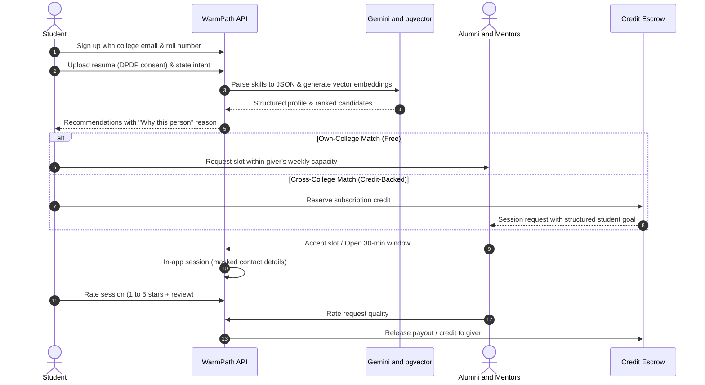
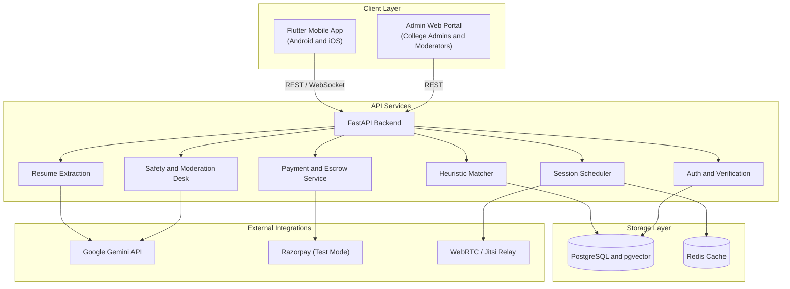
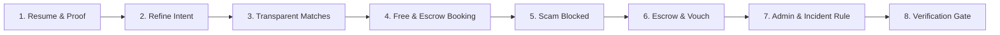

# WarmPath

Building a network, not a directory. A closed, institution-verified alumni network matched by expertise and intent.

[](LICENSE)
[](https://fastapi.tiangolo.com)
[](https://flutter.dev)
[](https://github.com/pgvector/pgvector)
[](https://ai.google.dev)

---

## At a glance

- **What it is**: An intent-first alumni network where students connect with verified alumni and experts for structured mentorship sessions, instead of sending unread cold messages into static directories.
- **Who it is for**: College students who lack a personal professional network, busy alumni who want bounded ways to help without being spammed, and college placement cells that want real visibility into mentoring outcomes.
- **Current status**: We are currently in the hackathon ideation and prototype round. The architectural specifications, data contracts, trust models, and matching heuristics are locked. Core API endpoints and mobile UI flows are in progress.
- **Demo Link**: <!-- TODO: add demo link -->
- **Demo Video**: <!-- TODO: add demo video link -->

---

## The problem

Students at non-metro or lesser-known colleges start with almost zero professional network. When they reach out to strangers on open platforms like LinkedIn, their cold messages go unanswered 95% of the time because students rarely know how to write a clear, specific request.

At the same time, alumni want to give back to their alma mater, but their time is limited. Without boundaries, they get overwhelmed by vague messages asking for immediate job referrals.

Colleges try to solve this by purchasing alumni software, but these platforms usually end up as dead directories. Nobody knows if any actual mentoring happened after orientation week.

Finally, open networks are easy to game. Students are routinely targeted by fake recruiter profiles, phishing links, and job offers demanding upfront "registration fees" or "security deposits", with bad actors constantly pushing conversations to private WhatsApp or Telegram chats.

---

## What WarmPath does

WarmPath changes how college networking works through four core principles:

1. **Free for your own college**: Every student gets free, verified access to alumni from their own institution, bounded only by the alumnus's weekly capacity.
2. **Paid cross-college reach**: Students who want to consult alumni from other colleges, founders, or domain experts can book time using subscription credits. Givers are paid for their time.
3. **Ratings decide earnings, not college pedigree**: What a giver earns depends entirely on ratings and feedback from students they have helped (in Rising, Trusted, and Top Rated bands), never on how prestigious their own college is.
4. **Safety by design**: Verification is checked at registration, communication stays in-app without revealing phone numbers or emails, payments run through an escrow-style hold, and automated rules flag recruitment scams.

---

## How it fits the hackathon theme

**Theme 1: Alumni Network and Professional Connections**  
*Theme line: Building a Network, Not a Directory*

A directory lists profiles and leaves users to fend for themselves. A network matches by intent, schedules real time, protects both parties, and measures whether the connection helped.

| User | What they do | What they get |
| :--- | :--- | :--- |
| **Student** | Uploads resume, states intent, connects, books, and rates. | Relevant guidance, interview prep, and introductions without needing an existing network. |
| **Alumnus** | Sets weekly availability, accepts requests in one tap, and holds sessions. | Fair compensation for cross-college sessions, credits, reputation, or an option to donate to student scholarships. |
| **Faculty / Expert** | Mentors students on academic topics and reviews projects. | Compensated time and a verified expert profile. |
| **Founder** | Hosts AMA slots, reviews portfolios, and speaks with students. | Access to pre-matched candidate pools and a verified employer badge. |
| **Recruiter** | Conducts verified hiring outreach and screening chats. | Direct pipeline to interested students with verified credentials. |
| **Institution** | Verifies alumni lists, monitors dashboard, and funds seats. | Real metrics on session volume, turnaround times, emerging skill gaps, and verified outcomes. |

- **Expertise**: Extracted directly from the student's resume via an LLM into structured skills, domains, and project histories.
- **Intent**: Captured from one clear question at onboarding: *"What do you want next?"* (e.g., frontend developer internship, GRE prep, or fintech startup advice).
- **Opportunities**: Built into the platform through 1-on-1 mentorship, project reviews, referral conversations, and campus talks.

---

## Feature status

| Feature Group | Status | Audit Verification |
| :--- | :---: | :--- |
| **F1–F3: Auth, Verification & Badges** | **Built & Verified** | Argon2 password hashing, OTP verification, layered badges (`Verified Student`, `Alumnus`, `Expert`, `Employer`). |
| **F4–F5: Resume & Proof of Work** | **Built & Verified** | Magic byte `%PDF-` validation, AI parsing, confirmed skills labeling, GitHub proof-of-work link verification. |
| **F6–F7: Intent Structuring & Quality** | **Built & Verified** | Vague ask transformation, technical objective structuring, suggested refinements, contact solicitation blocking. |
| **F8–F10: Transparent Matcher & Gates** | **Built & Verified** | 6-factor explainable weights (35/25/15/10/10/5), why-this-match reasons, capacity & safety hard exclusion gates. |
| **F11–F13: Availability & Trust Limits** | **Built & Verified** | 3 states (`Active now`, `Available today`, `Inactive`), weekly caps, graduated request limits by trust score. |
| **F14–F17: Request Lifecycle & Security** | **Built & Verified** | State machine, contact masking in chat, real-time regex scam detection middleware, synthetic Jitsi Meet links. |
| **F18–F19: Single Credit Escrow & Seats** | **Built & Verified** | ₹0 same-college reach, cross-college 80/20 escrow release, zero-net immutable ledger, sponsored seat vouchers. |
| **F20–F23: Reputation, Bands & Anti-Gaming** | **Built & Verified** | Post-session tag ratings, Bayesian smoothed bands, 1-click vouching, mutual rating ring anti-gaming filters. |
| **F24–F27: Opportunities & Other Givers** | **Built & Verified** | Verified faculty domain mentors, verified employer job/referral postings, candidate opt-in privacy, alumni counts. |
| **F28–F32: Admin, Incident Learning & Graph**| **Built & Verified** | Analytics overview, skill gap analysis, moderation queue, automated scam rule learning, 7 live trust layers. |
| **F33–F36: Privacy, Pilot Gates & Jury Demo** | **Built & Verified** | DPDP consent lifecycle, JSON data export, account deletion, pilot metrics gate, 8-step Jury Demo walkthrough. |

> See [FEATURES.md](FEATURES.md) for the 36-feature matrix and [AUDIT_REPORT.md](AUDIT_REPORT.md) for live test evidence.

---

## How it works



### Student journey (8 steps)
1. **Sign up and verify**: College email confirms the institution. Roll or enrolment numbers are matched against an approved list.
2. **Upload resume**: With explicit consent under the DPDP Act, the resume is parsed into skills, domain knowledge, projects, and education. Students can review and edit all extracted data.
3. **Add intent**: The student answers one prompt: *"What do you want next?"*
4. **See recommendations**: Best-fit alumni from the same college appear first for free, each showing a clear "Why this match" reason and an online indicator.
5. **Connect**: Free connection for own-college alumni within their capacity. Cross-college alumni and external experts are unlocked via subscription credits.
6. **Instant or booked**: If a giver has an active 30-minute "Open Now" window, connect immediately. Otherwise, pick an open calendar slot.
7. **In-app session**: Audio or video call runs through an embedded link. Phone numbers and personal emails are never revealed.
8. **Rate**: The student gives a 1 to 5 rating with a short note. The giver rates request quality. Payout is released only after this step.

### Giver journey
Alumni, founders, faculty, and recruiters verify their identity, set a strict weekly capacity (such as 2 or 3 sessions per week), and optionally toggle an "open for 30 minutes" status. They receive well-structured requests with clear agendas, accept in one tap, and hold calls inside the app. For cross-college calls, they earn credits or cash based on their rating band, which they can withdraw, spend on other experts, or donate to a student scholarship pool.

---

## Architecture and technical choices



| Component | Choice | Practical reason |
| :--- | :--- | :--- |
| **Client** | Flutter | A single codebase allows our 4-person team to build for Android and iOS without maintaining separate UI code. |
| **Backend** | FastAPI (Python) | High-performance asynchronous endpoints with built-in Pydantic validation, which fits structured LLM JSON outputs. |
| **Database** | PostgreSQL + pgvector | We already require Postgres for relational data (users, sessions, trust levels). Using `pgvector` lets us perform vector similarity search without paying for or running a separate vector database. |
| **Cache & Queue** | Redis | Fast storage for transient state like active 30-minute "Open Now" windows, user rate limits, and live capacity counters. |
| **AI / Extraction** | Google Gemini API | Reliable JSON extraction from resume text, intent structuring, and keyword scanning for flagged messages. |
| **Video Relay** | Embedded Jitsi / Meet links | Enables quick, zero-cost calling where neither party needs to share their phone number or personal email. |
| **Payments** | Razorpay (test mode) | Provides standard Indian payment methods with sandbox support for subscription handling and split payouts. |

---

## Matching: how recommendations work

In Version 1, recommendations use a **transparent heuristic score**, not a black-box machine learning model. Every score can be explained to the student:

$$\text{Score} = 0.35E + 0.25I + 0.15A + 0.10C + 0.10R + 0.05O$$

| Signal | Weight | What it uses | Purpose |
| :--- | :---: | :--- | :--- |
| **Expertise fit ($E$)** | **35%** | Resume skills and projects vs. giver profile (cosine similarity) | Ensures technical relevance. |
| **Intent fit ($I$)** | **25%** | Student's stated goal vs. topics the giver explicitly offers | Matches direction, not just past coursework. |
| **Affinity ($A$)** | **15%** | Same college, department, or student society | Higher initial reply likelihood. |
| **Availability ($C$)** | **10%** | Online status, open windows, remaining weekly capacity | Prevents over-routing to busy people. |
| **Rating band ($R$)** | **10%** | Historical average rating and completion record | Rewards consistently helpful mentors. |
| **Response odds ($O$)** | **5%** | Past acceptance rate and turnaround time | Minimizes dead-end requests. |

> **Hard Gates**: Unverified or restricted accounts are never recommended. Givers who have hit their weekly session quota are temporarily excluded from search results.

---

## Ratings and trust score

We do not use arbitrary "Tier 1 / Tier 2" college rankings. Instead, two distinct mechanisms run independently:

1. **Ratings decide pay and visibility**:
   - Students rate every completed session (1 to 5 stars plus a short explanation).
   - Givers belong to one of three rating bands: **Rising** (starting band), **Trusted**, or **Top Rated**.
   - Higher bands receive a larger payout share and better placement in search results.
   - To keep ratings fair, givers have a buffer of minimum rated sessions (such as 5) before their band shifts, preventing a single poor rating from dropping someone immediately.
   - Ratings are calculated using a smoothed average, and only completed sessions where both parties met the minimum call duration can be reviewed.
   - Givers also rate request quality, which pushes students to write clear agendas and reduces spam.

2. **The trust score controls safety limits**:
   - Each account has an internal trust score based on verification level, completion rate, account age, and report history.
   - The trust score determines daily action limits (e.g., maximum requests per day, permission to post opportunities).
   - The trust score is completely private, is never used as a public ranking, and has no impact on session earnings.

---

## Trust, safety, and privacy

<details>
<summary><strong>View the 7-layer trust model and privacy rules</strong></summary>

### The 7 defensive layers

| Layer | What we do | Risk it stops |
| :--- | :--- | :--- |
| **1. Identity at entry** | Students & alumni verify via institutional email and roll numbers. Recruiters verify via company domains and business checks (CIN/GST). | Fake alumni, impersonation, unverified recruiters. |
| **2. Layered badges** | Explicit badges for `Verified Student`, `Verified Alumnus`, `Verified Employer`, and `Verified Expert`. | Fake credibility and misleading profiles. |
| **3. Graduated privileges** | New accounts start with low daily request limits and cannot post jobs until a verified track record exists. | Throwaway accounts and bulk spam. |
| **4. In-app communication** | Calls and messaging happen in-app. Phone numbers and personal emails remain hidden. | Off-platform scams and external harassment. |
| **5. Scam detection** | Automated filters flag words like "registration fee", "security deposit", or links to Telegram/WhatsApp. | Recruitment fraud and upfront payment scams. |
| **6. Human moderation queue** | One-tap reporting on profiles and chats with a pilot review target of 24 hours. Repeat offenders are permanently banned by institutional ID. | Harassment and repeat bad actors. |
| **7. Incident review** | Every upheld report generates a brief post-mortem to update automated detection rules. | The same exploit happening twice. |

### Recruiter & job safety rules
- Recruiters cannot post opportunities or message students until their company registration is verified.
- Any message requesting payment from a student for an interview or test is blocked immediately with a warning banner, and repeated attempts result in a permanent ban.

### Data privacy by design (DPDP Act)
- Resumes are parsed only after explicit consent, and students can view, edit, or delete extracted fields before they are stored.
- Resumes are never indexed publicly or shown to third parties; they are visible only to the specific alumnus a student requests time with.
- Students can download or permanently delete their data at any time.

*Implementation Note: Trust rules and data privacy workflows are currently in the design specification stage.*
</details>

---

## Plans, unit economics, and fairness

Connecting with alumni from your own college is **always free**. Subscriptions apply only to students who choose to reach across colleges to external experts and founders.

### Illustrative plans

| Feature | Standard | High | Premium |
| :--- | :---: | :---: | :---: |
| **Own-college alumni** | Free (within capacity) | Free (within capacity) | Free (within capacity) |
| **Monthly session credits** | Few | More | Most |
| **Reach** | Limited cross-college | Wider (Trusted & above) | All bands, founders, recruiters |
| **Instant connect** | Basic | Included | Highest priority |
| **Response guarantee** | Credit back if no reply in 72h | Credit back if no reply in 72h | Credit back if no reply in 72h |
| **Illustrative price** | Low | ₹499 / month | Higher |

### Illustrative unit economics
In an illustrative ₹499 plan with 2 session credits (roughly ₹250 revenue per session):
- **Rising band (60% share)**: Giver earns ₹150; platform retains ₹100.
- **Trusted band (70% share)**: Giver earns ₹175; platform retains ₹75.
- **Top Rated band (80% share)**: Giver earns ₹200; platform retains ₹50.

*Note: All money figures and payout shares are illustrations for the pitch. Real pricing and unit economics will be finalized with financial guidance prior to a commercial launch. During the build, all payments run in test mode.*

### Is it fair to charge for cross-college access?
Charging for cross-college reach is not "pay-to-network". Every student receives free access to their own college's alumni base. The subscription compensates external professionals for their scarce time. What givers earn depends strictly on student reviews, never on college prestige. Furthermore, colleges and alumni can fund sponsored seats and scholarship pools so students who cannot pay still get access.

---

## Getting started

### Prerequisites
- Python 3.11+
- Flutter SDK (3.19+)
- Docker & Docker Compose (optional for local PostgreSQL and Redis; prototype defaults to SQLite)

### 1. Clone the repository
```bash
git clone https://github.com/AnmolGarg8/WarmPath.git
cd WarmPath
```

### 2. Set up Python virtual environment & dependencies
```bash
python -m venv .venv

# On Windows (PowerShell):
.\.venv\Scripts\Activate.ps1
# On macOS/Linux:
source .venv/bin/activate

pip install -r backend/requirements.txt
```

### 3. Run the backend service (FastAPI)
From the repository root (or inside `backend/`):
```bash
# From repository root:
uvicorn app.main:app --app-dir backend --reload --port 8000
```
- **Web UI & Interactive Demo**: `http://localhost:8000/` or `http://localhost:8000/demo`
- **Interactive Swagger Documentation**: `http://localhost:8000/docs`
- **Admin Analytics Dashboard**: `http://localhost:8000/admin/dashboard`

### 4. Run automated test suites & feature audit
```bash
# Run complete pytest suite (62 tests, 87% coverage):
pytest backend/tests

# Run live 36-feature audit against running server:
python scripts/audit_features.py
```

### 5. Run the Flutter mobile app (optional)
```bash
cd mobile
flutter pub get
flutter run
```

---

## Demo credentials & accounts

All demo accounts share the standard password `DemoPassword123!`. The database can be reset to this clean state at any time via `POST /demo/reset`.

| Role | Email | Password | Purpose & Context |
| :--- | :--- | :--- | :--- |
| **Student** | `aditi.sharma@iiitd.ac.in` | `DemoPassword123!` | IIIT Delhi CS student seeking SWE mentorship and resume review. |
| **Alumnus (Same-College)** | `rohan.sharma@microsoft.com` | `DemoPassword123!` | IIIT Delhi alumnus at Microsoft; ₹0 / 0 credit free connection. |
| **Alumnus (Cross-College)**| `priya.patel@google.com` | `DemoPassword123!` | NSUT alumna at Google; paid cross-college reach via escrow credits. |
| **Faculty Expert** | `vivek.kumar@iiitd.ac.in` | `DemoPassword123!` | IIIT Delhi Professor & ML mentor with verified expert badge. |
| **Recruiter** | `neha.verma@zomato.com` | `DemoPassword123!` | Zomato hiring lead; verified employer posting tech roles and chats. |
| **Institution Admin** | `career.admin@iiitd.ac.in` | `DemoPassword123!` | IIIT Delhi Career Cell admin; oversees analytics, reports & gates. |

---

## 8-step jury demo story walkthrough

The running platform includes a guided Jury Demo workflow accessible at `GET /demo` and `GET /demo/story/status`. It demonstrates the complete end-to-end user journey across 8 verified steps:



1. **Step 1: Upload resume & confirm skills**: Student uploads resume PDF (magic byte validated), Gemini extracts technical skills, student confirms skills, and connects verified GitHub proof-of-work link. (`POST /demo/story/step/1`)
2. **Step 2: Vague intent refinement**: Student submits vague objective (*"want help in tech"*); AI structures it into an actionable technical agenda while filtering contact solicitation. (`POST /demo/story/step/2`)
3. **Step 3: Transparent recommendations**: Heuristic matcher scores givers with explainable reasons (35% skills, 25% intent, 15% college, 10% availability, 10% rating, 5% response) and excludes inactive/capped profiles. (`POST /demo/story/step/3`)
4. **Step 4: Book sessions (Free vs Escrow)**: Student books same-college alumnus for **0 credits** ($0) and cross-college alumnus with **5 credits** held in escrow. Calendar slots and synthetic Jitsi links are generated. (`POST /demo/story/step/4`)
5. **Step 5: Scam detection in chat**: A fraudulent message requesting registration fees and off-platform WhatsApp contact is intercepted in real-time by the scam regex middleware and blocked. (`POST /demo/story/step/5`)
6. **Step 6: Completion, escrow release & vouching**: Both parties mark session complete; 80% credits release to giver and 20% to platform; student gives 5-star rating and giver vouches for student. (`POST /demo/story/step/6`)
7. **Step 7: Admin oversight & incident learning**: College admin inspects request turnaround times and skill gaps, resolves a scam report, and automatically learns a new scam pattern into `scam_rules`. (`POST /demo/story/step/7`)
8. **Step 8: Identity verification hard gates**: A fraudulent applicant without college roster records is rejected, while an authorized institution member auto-verifies with instant badge assignment. (`POST /demo/story/step/8`)

> **One-Click Reset**: Run `POST http://localhost:8000/demo/reset` at any point to restore fresh demo seed data.

---

## Repository structure

```text
WarmPath/
├── .env.example            # Template for environment configuration
├── .gitignore              # Ignored paths for Python, Flutter, and environment files
├── LICENSE                 # MIT License file
├── README.md               # Main project overview and hackathon brief
├── docs/                   # Extended design and specification documents
│   ├── ARCHITECTURE.md     # Deep-dive system topology and component contracts
│   └── TRUST_AND_SAFETY.md # Detailed 7-layer trust and compliance rules
├── backend/                # FastAPI application (in progress)
├── mobile/                 # Flutter mobile client (in progress)
└── web-admin/              # Institution management portal (planned)
```

---

## 90-day single-college pilot roadmap

We follow a strict launch gate rule: **we do not expand to a second college until the pilot college meets its exit conditions.**

<details>
<summary><strong>View the 3-phase pilot plan</strong></summary>

```
Days 1 - 30                 Days 31 - 60                Days 61 - 90
[ PHASE 1: PREPARE ]        [ PHASE 2: OPEN ]           [ PHASE 3: PROVE ]
├── Sign alumni cell        ├── Batch student invites   ├── Enable paid tier
├── Verify 50 real givers   ├── Moderate flagged items  ├── Review dashboard
└── Legal & DPDP checks     └── Track 72hr reply rate   └── College licence decision
```

- **Phase 1 (Days 1–30: Prepare)**: Partner with one institution's alumni cell, obtain approved roster lists, onboard 50 verified alumni givers, and run internal tests.  
  *Exit condition*: 50 verified givers live; terms reviewed; test-mode payments functioning.
- **Phase 2 (Days 31–60: Open to students)**: Invite students in batches, track turnaround times and feedback weekly, and handle moderation reports manually.  
  *Exit condition*: At least 60% of requests answered within 72 hours; zero unresolved serious reports.
- **Phase 3 (Days 61–90: Prove it)**: Enable the cross-college paid plan for a test group, share the engagement dashboard with college leadership, and run post-mortems on every incident.  
  *Exit condition*: Pilot goals met and reviewed; decision on paid institutional licensing.
</details>

---

## Business model and pilot targets

### Revenue streams
- **Student subscriptions**: Standard, High, and Premium tiers funding cross-college payouts and platform margins.
- **Institutional licences**: Annual fee paid by colleges and alumni offices for the analytics dashboard and student career tracking.
- **Sponsored seats**: Subsidized credits funded by colleges, alumni associations, or CSR initiatives for students needing financial assistance.

### Pilot targets (not final results)
- Higher reply rates and faster first responses compared to cold LinkedIn messages.
- Measurable access for students from non-metro colleges who have no existing network.
- High giver retention due to strict capacity limits and fair compensation.
- Lower scam rates through mandatory identity verification and in-app communications.
- Metrics to track: fulfillment rate, time to first response, average session rating, repeat giver percentage, and reports per 1,000 users.

---

## How we differ from similar products

We respect existing products in the market, but we address different use cases:

- **Topmate & ADPList**: These platforms focus on individual creators and monetizing expert time on an open marketplace. WarmPath starts with a free, closed alumni layer, matches on resume data and explicit intent, and ties earnings to student ratings rather than self-set fees.
- **PeopleGrove, Graduway & Almabase**: These tools are sold to university administrations primarily as alumni directories and donor management systems. WarmPath is built for active 1-on-1 student routing, strict capacity limits, and verified session outcomes.
- **LinkedIn**: An open professional network where anyone can message anyone. Because it is open, it suffers from spam, unverified recruiters, and job scams asking for fees. WarmPath is closed, verified against college records, and keeps all messaging and calling inside the platform.

---

## Known limitations and risks

Being honest about challenges is essential to building a dependable platform:

1. **Cold start challenge**: A two-sided network requires both students and alumni to be active. We address this with our single-college playbook: seeding 50 verified alumni before inviting any students.
2. **Giver inactivity**: Mentors can lose momentum over time. We use weekly capacity caps, 30-day activity check-ins, and auto-removal from search after 90 days of inactivity so students never message inactive profiles.
3. **Moderation turnaround**: Our 24-hour incident review target is a pilot goal that depends on having a dedicated team member or college staff member available. We will not promise instant moderation at scale until it is properly staffed.
4. **Current prototype status**: The FastAPI modular backend, database persistence, and interactive web demo portal are built and verified across all 36 features in `FEATURES.md` (62/62 automated tests passing, 36/36 live feature audit passing; see [AUDIT_REPORT.md](AUDIT_REPORT.md)). The Flutter mobile client codebase is in development for cross-platform deployment.

---

## The team

Built by **Team Unsolved Loop** from **VIPS-TC**:

- **ANMOL GARG** (M1 - Platform, Trust & Safety) <!-- TODO: add GitHub handle -->
- **TANUSH YADAV** (M2 - Resume & Matching) <!-- TODO: add GitHub handle -->
- **AYUSH GHANSHALA** (M3 - Availability & Sessions) <!-- TODO: add GitHub handle -->
- **SNEHA SINHA** (M4 - Credits & Dashboards) <!-- TODO: add GitHub handle -->

See [OWNERS.md](OWNERS.md) for directory ownership and [CONTRIBUTING.md](CONTRIBUTING.md) for branch workflow.

### AI Assistance Disclosure
AI coding assistants were used to accelerate monorepo scaffolding and initial boilerplate generation. Each team member reviews, tests, and validates their own assigned modules.

---

## Licence and acknowledgements

- **Licence**: Distributed under the MIT Licence. See [LICENSE](LICENSE) for full details.
- **Acknowledgements**: We thank the faculty and the alumni cell at Vivekananda Institute of Professional Studies - Technical Campus (VIPS-TC) for feedback on our initial assumptions and workflow design.

